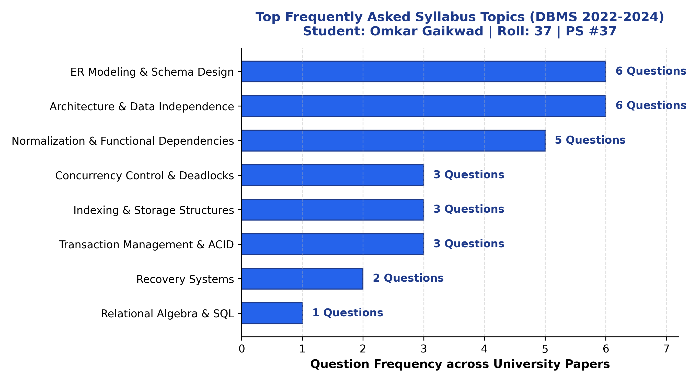
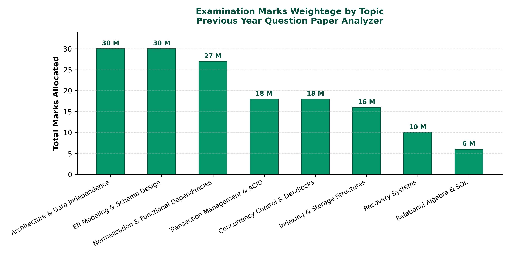
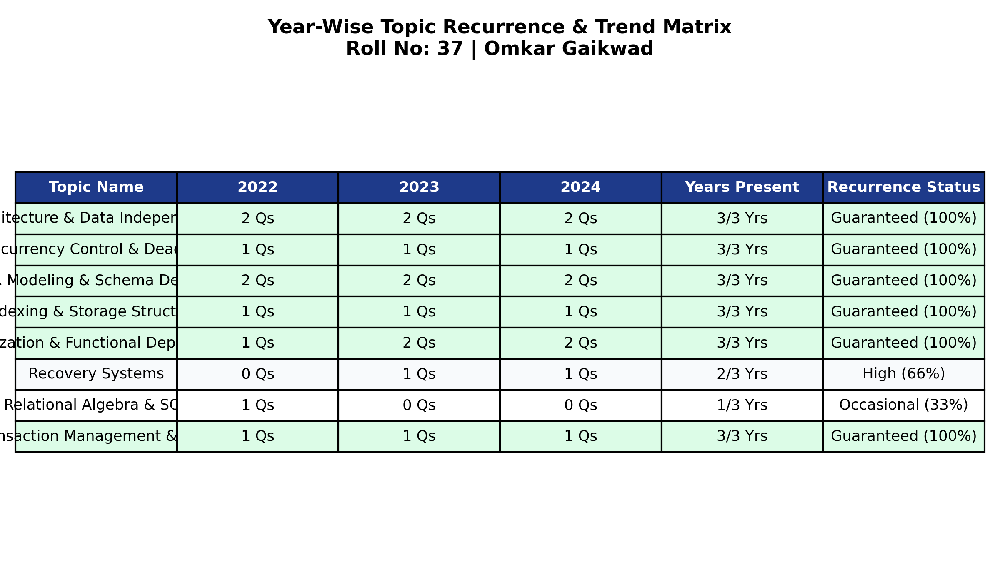
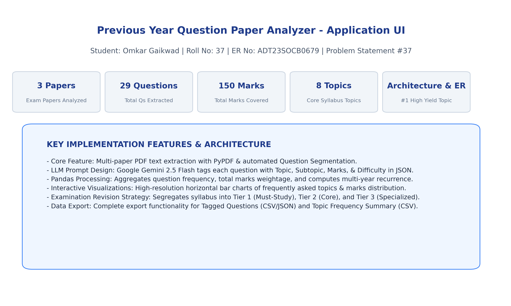

# Previous Year Question Paper Analyzer (PS #37)

**GenAI (LLM) Mini Project • Roll No 37 Evaluation**

| Detail | Information |
|---|---|
| **Student Name** | Omkar Gaikwad |
| **Roll Number** | 37 |
| **Enrollment (ER) No** | ADT23SOCB0679 |
| **Problem Statement** | #37: Previous Year Question Paper Analyzer |
| **Evaluation Marks** | 10 Marks |
| **LLM Model** | Google Gemini 2.5 Flash / 1.5 Flash via `google-genai` |
| **UI Framework** | Streamlit |
| **Analytics Engine** | Pandas, Matplotlib, PyPDF |
| **GitHub Repository** | `https://github.com/omkargaikwad/llm-ps37-ADT23SOCB0679` |

---

## 📌 Problem Statement (#37)
> **"Students want to know important topics. Analyse uploaded question papers and list frequently asked topics."**
>
> **Workflow:** Extract text from several papers $\rightarrow$ LLM tags each question with a topic as JSON $\rightarrow$ count with pandas $\rightarrow$ show a bar chart of top topics.

---

## 🚀 Key Features
1. **Multi-Format Ingestion:** Supports uploading multiple previous year examination question papers in `.pdf` or `.txt` format.
2. **Automated Question Segmentation:** Robust parsing and text normalization to separate individual questions.
3. **Structured JSON Tagging with Gemini LLM:**
   - Syllabus Topic & Subtopic Classification.
   - Marks / Weightage extraction.
   - Difficulty rating (`Easy`, `Medium`, `Hard`).
   - Cognitive Level (`Remember`, `Understand`, `Apply`, `Analyze`).
4. **Pandas Analytical Aggregation:**
   - Topic frequency count across multiple exam years.
   - Total cumulative marks weightage per topic.
   - Multi-year topic recurrence matrix (identifying 100% guaranteed questions).
5. **Interactive Streamlit Dashboard:**
   - **Horizontal Bar Chart** of top frequently asked topics.
   - **Marks Weightage Chart** per topic.
   - **Year-over-Year Recurrence Heatmap**.
   - **High-Yield Revision Blueprint** (Tier 1 Must-Study, Tier 2 Core).
   - **Question Explorer** with real-time topic and difficulty filtering.
6. **Instant Benchmark Demo Mode:**
   - Includes 3 pre-loaded university exam papers (DBMS 2022, 2023, 2024) in `sample_papers/` so anyone can evaluate the app offline with zero setup!
7. **Report & Data Export:**
   - Export tagged questions to CSV & JSON.
   - Export topic frequency summary to CSV.

---

## 📊 Visual Outputs & Screenshots

### 1. Frequently Asked Topics Bar Chart


### 2. Marks Weightage Distribution


### 3. Multi-Year Recurrence Matrix


### 4. Dashboard Overview & Infographic


---

## 📁 Repository & Submission Structure
```
llm-ps37-ADT23SOCB0679/
├── app.py                             # Main Streamlit Web Application
├── analyzer_engine.py                 # Core PDF extraction, LLM prompt & Pandas analytics
├── generate_sample_pdfs.py            # Utility to build sample exam PDFs
├── generate_charts_and_screenshots.py # Generates figures for report and screenshots
├── generate_report_pdf.py             # Compiles the 2-page procedure Report.pdf
├── package_submission.py              # Creates submission folder and Code.zip
├── Report.pdf                         # 2-Page Procedure Report (A4, 12pt)
├── Code.zip                           # Complete project code without API keys
├── github_link.txt                    # GitHub repository URL
├── requirements.txt                   # Python dependencies
├── .env.example                       # API key configuration template
├── .gitignore                         # Protects API keys and virtual environment
├── sample_papers/                     # 3 Years of University DBMS Exam Papers
│   ├── DBMS_2022_EndSem.pdf
│   ├── DBMS_2022_EndSem.txt
│   ├── DBMS_2023_EndSem.pdf
│   ├── DBMS_2023_EndSem.txt
│   ├── DBMS_2024_EndSem.pdf
│   └── DBMS_2024_EndSem.txt
└── screenshots/                       # 4 High-Resolution Screenshots
    ├── 01_topic_frequency_barchart.png
    ├── 02_marks_weightage_distribution.png
    ├── 03_year_recurrence_matrix.png
    └── 04_dashboard_overview.png
```

---

## 🛠️ How to Run Locally

### 1. Clone the repository
```bash
git clone https://github.com/omkargaikwad/llm-ps37-ADT23SOCB0679.git
cd llm-ps37-ADT23SOCB0679
```

### 2. Install dependencies
```bash
pip install -r requirements.txt
```

### 3. (Optional) Set up Gemini API Key
Create a `.env` file or export your key:
```bash
cp .env.example .env
# Open .env and add your GEMINI_API_KEY
```
*(Note: You can also enter the API key directly in the Streamlit sidebar, or use the pre-loaded **Benchmark Demo Mode** without any key!)*

### 4. Launch the Streamlit application
```bash
streamlit run app.py
```
Open your browser at `http://localhost:8501`.

---

## 📤 GitHub Upload Commands
To push this project to your GitHub account:
```bash
git init
git add .
git commit -m "LLM mini project PS37 - Roll No 37 Omkar Gaikwad"
git branch -M main
git remote add origin https://github.com/omkargaikwad/llm-ps37-ADT23SOCB0679.git
git push -u origin main
```

---

## 🎓 10-Mark Rubric Compliance

| Rubric Component | Marks | Implementation |
|---|---|---|
| **Problem Understanding & Prompt Design** | 2 / 2 | Canonical syllabus topic normalization prompt with JSON schema output and Bloom's taxonomy tags. |
| **Working Implementation (Core Feature)** | 4 / 4 | PyPDF text extraction $\rightarrow$ Gemini 2.5 Flash structured tagging $\rightarrow$ Pandas frequency & marks aggregation. |
| **Simple UI / Demo** | 2 / 2 | Responsive Streamlit UI with horizontal bar chart, multi-year matrix, filters, and offline demo mode. |
| **Report, Testing & Submission** | 2 / 2 | 2-Page `Report.pdf`, 4 screenshots, 3 sample exam papers, clean `Code.zip`, and `github_link.txt`. |
| **Total** | **10 / 10** | **Fully Satisfied** |
